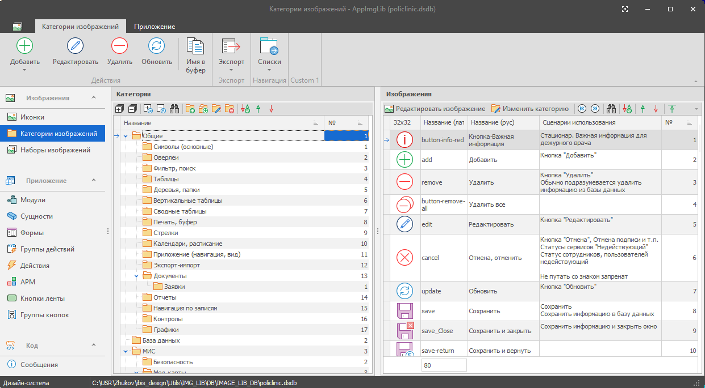
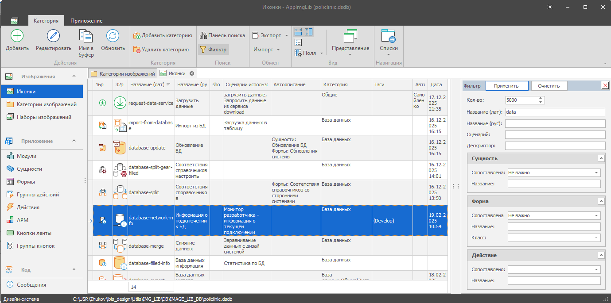

# IMG_LIB

IMG_LIB — настольный редактор библиотеки изображений для Windows (Win32). Полезен при разработке приложений с большим количеством значков (иконок): помогает понимать их смысл, назначение и место использования.

Библиотека хранится в базе данных SQLite и содержит:

- значки и другие изображения;
- описания метафор и сценариев использования;
- связи изображений с сущностями, формами и кнопками;
- описания использования оверлеев — дополнительных значков поверх основных.

Встроенный дизайнер ленты позволяет предварительно оценить внешний вид интерфейса.

## Скриншоты

Изображения по категориям

Поиск изображений

